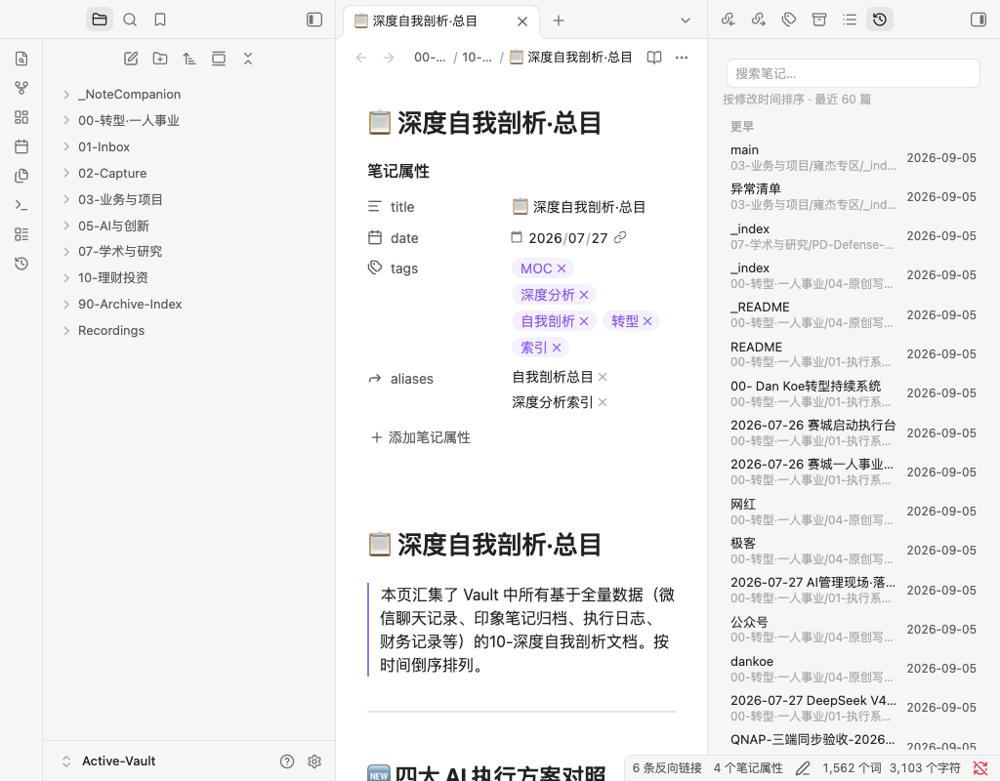

# 最近修改 · Obsidian 插件

在 Obsidian 侧边栏加一个「最近修改」视图：按笔记修改时间从新到旧列出，按 **今天 / 昨天 / 近 7 天 / 近 30 天 / 更早** 分组，支持搜索、悬停预览，编辑笔记时自动刷新。



纯 JavaScript，无构建、无第三方依赖，桌面端与移动端均可使用。

## 功能

- 按修改时间倒序，日期分组（组标题吸顶）
- 每行显示标题、所在文件夹、相对时间（"3 分钟前"）
- 顶部搜索框按标题 / 路径过滤
- 编辑、新建、删除、重命名笔记时实时刷新
- 点击打开，⌘/Ctrl + 点击开新标签页，支持拖拽到其他窗格
- 悬停预览（依赖核心插件「页面预览」）
- 前置元数据里有 `updated` / `modified` 字段时，与文件时间取较新者（可关闭）
- 功能区时钟图标 + 两条命令：`打开最近修改视图`、`打开最近修改的那篇笔记`

## 安装

### 方式一：BRAT（推荐，可一键更新）

1. 安装并启用 [BRAT](https://github.com/TfTHacker/obsidian42-brat) 插件
2. 命令面板执行 `BRAT: Add a beta plugin for testing`
3. 填入仓库地址 `masterlinc/obsidian-recent-notes`
4. 在 设置 → 第三方插件 里启用「最近修改」

### 方式二：手动安装

把 `manifest.json`、`main.js`、`styles.css` 放到：

```
你的库/.obsidian/plugins/recent-notes/
├── manifest.json
├── main.js
└── styles.css
```

然后**完全退出并重新打开 Obsidian**（插件列表只在启动时扫描），
设置 → 第三方插件 → 关闭「受限模式」→ 启用「最近修改」。

> 受限模式是**每台电脑各自保存**的，不在库文件里，所以每台机器都需要手动关一次。
> 而「已启用插件」列表在 `.obsidian/community-plugins.json` 里，会随库同步。

### 方式三：从源码

```bash
git clone https://github.com/masterlinc/obsidian-recent-notes.git
VAULT="$HOME/Documents/你的库"
mkdir -p "$VAULT/.obsidian/plugins/recent-notes"
cp obsidian-recent-notes/{manifest.json,main.js,styles.css} "$VAULT/.obsidian/plugins/recent-notes/"
```

之后按方式二的最后两步操作。升级时重复 `git pull` + `cp`，再执行命令面板的「重新加载应用」。

## 设置

设置 → 第三方插件 → 最近修改：

| 选项 | 说明 | 默认 |
| --- | --- | --- |
| 显示数量 | 列表最多显示多少篇（1–500） | 60 |
| 按日期分组 | 今天 / 昨天 / 近 7 天 / 近 30 天 / 更早 | 开 |
| 显示所在文件夹 | 标题下方显示文件夹路径 | 开 |
| 优先使用笔记中的更新时间 | 前置元数据有 `updated` / `modified` 时取较新者 | 开 |
| 忽略的文件夹 | 每行一个，其中的笔记不显示 | `_NoteCompanion/Templates` |

## 兼容性

需要 Obsidian 1.4.0 及以上。只读取文件时间与元数据缓存，不改动任何笔记内容。

## 已知问题

如果整库是从别处拷贝/迁移来的，所有笔记的文件修改时间可能被压成同一时刻，此时历史排序没有真实信号；之后编辑的笔记会立刻正确排到最前面。原始库若还在，用 `cp -p` 或 `rsync -t` 拷贝可保留真实修改时间。

## 许可

MIT
